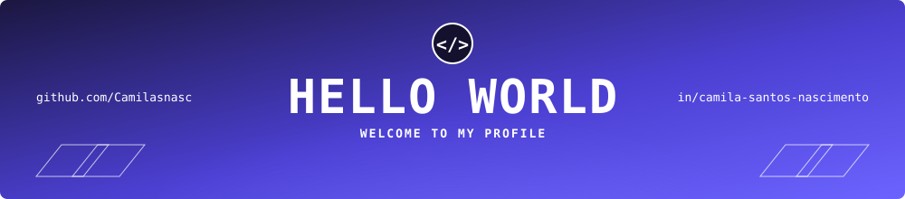
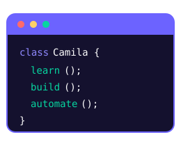

  

<h2>😎 I'M CAMILA!</h2>

<table>
  <tr>
    <td valign="top">
      
<em>Software Developer in the making — turning problems into solutions through code</em>

      
Estudante de Sistemas de Informação com foco em <strong>back-end</strong>, automação e <strong>Aprendizado por Reforço</strong>, apaixonada por qualidade de código e resolução de problemas.

      <ul>
        <li>🎓 Estudante de <strong>Sistemas de Informação</strong> na <strong>UFLA</strong> (Universidade Federal de Lavras)</li>
        <li>🏭 <strong>Jovem Aprendiz</strong> na <strong>InterCement</strong>, na área de <strong>PCM</strong> — automação de processos no SAP e dashboards de indicadores de manutenção</li>
        <li>🔬 Faço <strong>Iniciação Científica</strong> em <strong>Aprendizado por Reforço</strong> (Reinforcement Learning)</li>
        <li>🌱 Foco em <strong>back-end</strong>, qualidade de código, automação e resolução de problemas</li>
        <li>💬 Adoraria trocar ideias sobre tecnologia — sinta-se à vontade para me chamar!</li>
      </ul>
    </td>
    <td valign="top">
      
    </td>
  </tr>
</table>

---

### 🛠️ Technologies & Tools

  
  
  
  
  

---

### 💻 Languages

  
  
  
  

---

### 🎯 Current Focus

  
  
  
  

---

### 📫 Where to Find Me

  
  

  

